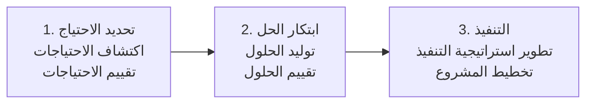

# الابتكار في الرعاية الصحية: من العلاج إلى الوقاية

> حزمة تعلّم ذاتي مبنية على ورشة **«الابتكار في الرعاية الصحية: من العلاج إلى الوقاية»** للدكتورة **Ahlam Althobaiti**، جامعة الطائف.

أفكار ابتكارية حقيقية، وخطوات تحويلها إلى مشروع.

## لمن هذه الحزمة؟

طلاب وممارسون صحيون ومهتمون بالصحة الرقمية والمعلوماتية الصحية، ممن يريدون فهم معنى الابتكار في الرعاية الصحية وكيف يبدؤون مشروعًا ابتكاريًا. لا تحتاج إلى خلفية تقنية.

## مخرجات التعلّم

بعد إكمال هذه الحزمة ستكون قادرًا على:

1. تعريف الابتكار والتمييز بينه وبين الاختراع.
2. تطبيق خمس خصائص للحكم على كون الفكرة ابتكارًا في الرعاية الصحية.
3. وصف ابتكارات مؤثرة في العلاج، والتشخيص المبكر والرعاية عن بُعد، والوقاية.
4. شرح المراحل الثلاث لنموذج ستانفورد (Stanford Biodesign): **تحديد الاحتياج ← ابتكار الحل ← التنفيذ**.
5. تحليل دراسة حالة سعودية (Sahl AI) وفق هذا النموذج.
6. صياغة احتياج ومفهوم أولي لمشكلة لاحظتها بنفسك.

## مسار التعلّم المقترح (نحو 3 ساعات)

| الخطوة | الوحدة | المدة |
|---|---|---|
| 1 | [ما هو الابتكار؟](docs/01-what-is-innovation.md) | 30 دقيقة |
| 2 | [الابتكار في الرعاية الصحية](docs/02-healthcare-innovation.md) | 20 دقيقة |
| 3 | [ابتكارات مؤثرة: من العلاج إلى الوقاية](docs/03-impactful-innovations.md) | 40 دقيقة |
| 4 | [خصائص الابتكار في الرعاية الصحية](docs/04-characteristics.md) | 25 دقيقة |
| 5 | [كيف نطوّر ابتكارًا؟ (Stanford Biodesign)](docs/05-stanford-biodesign.md) | 30 دقيقة |
| 6 | [دراسة حالة سعودية: Sahl AI](docs/06-saudi-case-study.md) | 30 دقيقة |
| 7 | [التمارين](exercises/exercises.md) | 45 دقيقة |
| 8 | [الاختبار](assessment/quiz.md) | 15 دقيقة |

مواد مساندة: [قاموس المصطلحات](docs/glossary.md) · [المراجع](docs/references.md)

## الإطار الأساسي باختصار



## هيكل المستودع

```
├── README.md
├── docs/            # ست وحدات تعليمية، قاموس المصطلحات، المراجع
├── exercises/       # أنشطة تطبيقية
├── assessment/      # اختبار مع مفتاح الإجابات
└── slides/          # العرض الأصلي للورشة (.pptx)
```

## ملاحظات حول المصادر

الحقائق والأرقام في الوحدات مأخوذة من شرائح الورشة ومن المصادر التي تستشهد بها (انظر [المراجع](docs/references.md)). بعض الأمثلة حديثة (2024 إلى 2026) وقد تتحدّث، لذا راجع المصدر الأصلي قبل الاستشهاد بأي رقم. يتضمن عرض الورشة صورًا من مصادر خارجية، فتحقّق من حقوق إعادة استخدامها قبل نشر الشرائح.

## الاعتمادات

محتوى الورشة: Dr. Ahlam Althobaiti، جامعة الطائف. أُعدّ هيكل الحزمة والملخصات المكتوبة من شرائح الورشة.
