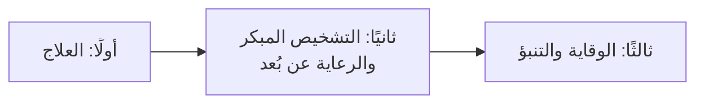

# 3. ابتكارات مؤثرة في الصحة الحديثة: من العلاج إلى الوقاية

**أهداف التعلّم:** وصف أمثلة بارزة في ثلاثة مجالات، وبيان ما يكشفه كل مثال عن الابتكار.

تُصنّف الورشة الأمثلة وفق ثلاث مراحل من رحلة الرعاية.

## 3.1 العلاج

| الابتكار | ما تذكره الورشة |
|---|---|
| **العلاج الجيني بتقنية كريسبر (CRISPR)** | في ديسمبر 2023 وافقت إدارة الغذاء والدواء الأمريكية على أول علاج جيني في الولايات المتحدة يعتمد على تقنية كريسبر (CRISPR-Cas9)، وهو **Casgevy** لعلاج **مرض الخلايا المنجلية**. وتتضمن المراجع كذلك الموافقة عليه في المملكة العربية السعودية (2024). |
| **أدوية السمنة (Semaglutide)** | في تجربة **SELECT** انخفضت الأحداث القلبية الكبرى من **8.0% إلى 6.5%** لدى مرضى السمنة المصابين بأمراض القلب دون الإصابة بالسكري. |
| **زراعة قلب روبوتية بالكامل** | في سبتمبر 2024 نجح مستشفى الملك فيصل التخصصي ومركز الأبحاث بالرياض في إجراء **أول عملية زراعة قلب روبوتية بالكامل في العالم** دون شق القفص الصدري بالطريقة التقليدية، لمريض يبلغ من العمر 16 عامًا يعاني من فشل قلبي في مرحلته النهائية. |

## 3.2 التشخيص المبكر والرعاية عن بُعد

| الابتكار | ما تذكره الورشة |
|---|---|
| **الذكاء الاصطناعي في التشخيص (LumineticsCore)** | في عام 2018 أجازت إدارة الغذاء والدواء الأمريكية أول **نظام ذكاء اصطناعي تشخيصي مستقل** للكشف عن **اعتلال الشبكية السكري** في الرعاية الأولية دون الحاجة إلى تفسير الطبيب لصور الشبكية. |
| **فحص الدم لعدة سرطانات (NHS-Galleri)** | شملت التجربة **أكثر من 142 ألف مشارك** في إنجلترا، وأظهرت نتائج عام 2026 انخفاضًا في تشخيص سرطانات المرحلة الرابعة وزيادة في اكتشاف السرطانات المبكرة. |
| **مستشفى صحة الافتراضي** | بحسب موسوعة غينيس، هو **أكبر مستشفى افتراضي في العالم**، ويقدم خدمات في **114 تخصصًا**. |

## 3.3 الوقاية والتنبؤ

تسرد الورشة هذه الفئات، وقد أضفنا الدراسات المستشهد بها للمتابعة.

| الابتكار | الفكرة | الدليل المستشهد به |
|---|---|---|
| **لقاحات الحمض النووي الريبوزي المرسال (mRNA Vaccines)** | لقاحات تستخدم الحمض النووي الريبوزي المرسال لتحفيز استجابة مناعية واقية | Polack et al., 2020 (NEJM): لقاح BNT162b2 لكوفيد-19 |
| **لقاح فيروس الورم الحليمي البشري (HPV Vaccine)** | يقي من عدوى مرتبطة بسرطان عنق الرحم | Lei et al., 2020 (NEJM): التطعيم ضد HPV وسرطان عنق الرحم الغازي |
| **الأجهزة القابلة للارتداء (Wearable Devices)** | أجهزة يومية ترصد الإشارات الصحية | Perez et al., 2019 (NEJM): ساعة ذكية لرصد الرجفان الأذيني |
| **الوقاية الرقمية من السكري (Digital Diabetes Prevention)** | برامج نمط حياة تُقدَّم تقنيًا للوقاية من السكري من النوع الثاني | Katula et al., 2022 (AJPM): تجربة عشوائية |
| **برنامج الفحص قبل الزواج والاستشارة الوراثية (السعودية)** | برنامج وطني للحد من اضطرابات الدم الوراثية | Memish & Saeedi, 2011 (Annals of Saudi Medicine) |

## ما الذي تشترك فيه هذه الأمثلة؟

- يبدأ كل مثال من **احتياج حقيقي** (مرض، تأخر في التشخيص، فجوة في الوصول).
- انتقل كل مثال من الفكرة إلى **الاستخدام العملي**، لا إلى نتيجة مخبرية فقط.
- عدد منها **سعودي المنشأ أو معتمد في المملكة**، ما يبرز دور المملكة في هذا المجال.

## اختبر فهمك

1. ضع كل مثال على مسار العلاج ← التشخيص ← الوقاية.
2. أي مثال يقلل الحاجة إلى تفسير الطبيب؟ وأيها يمدّ الرعاية إلى ما وراء جدران المستشفى؟
