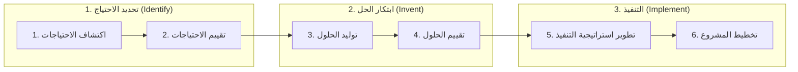

# 5. كيف نطوّر ابتكارًا؟

**أهداف التعلّم:** شرح المراحل الثلاث والخطوات الست لنموذج ستانفورد بايوديزاين وتطبيقها على مشكلة.

طوّر برنامج **Stanford Biodesign** التابع لجامعة ستانفورد نموذجًا منهجيًا للابتكار في الرعاية الصحية، بهدف توجيه المبتكرين من اكتشاف المشكلة الصحية إلى تطوير الحل وتطبيقه (Schwartz et al., 2016). ويعتمد النموذج على **ثلاث مراحل** و**ست خطوات**.

## المرحلة الأولى: تحديد الاحتياج (Identify)

| الخطوة | ما تفعله |
|---|---|
| **1. اكتشاف الاحتياجات (Needs Finding)** | تحديد الاحتياجات الصحية غير الملبّاة من خلال ملاحظة البيئة السريرية وفهم التحديات التي تواجه المرضى ومقدمي الرعاية الصحية. |
| **2. تقييم الاحتياجات (Needs Screening)** | تحليل الاحتياجات الصحية وتقييم أهميتها وفرص معالجتها لاختيار الاحتياجات ذات الأولوية للابتكار. |

## المرحلة الثانية: ابتكار الحل (Invent)

| الخطوة | ما تفعله |
|---|---|
| **3. توليد الحلول (Concept Generation)** | توليد مجموعة متنوعة من الأفكار والحلول المبتكرة التي تستجيب للاحتياجات الصحية المحددة. |
| **4. تقييم الحلول (Concept Screening)** | تقييم الحلول المقترحة وفق معايير الجدوى التقنية والتنظيمية والاقتصادية، واختيار الحلول الأكثر ملاءمة للتطوير والاختبار. |

## المرحلة الثالثة: التنفيذ (Implement)

| الخطوة | ما تفعله |
|---|---|
| **5. تطوير استراتيجية التنفيذ (Strategy Development)** | وضع استراتيجية متكاملة لتطوير الحل المبتكر، تشمل المتطلبات التقنية والسريرية والتنظيمية والموارد اللازمة للتنفيذ. |
| **6. تخطيط المشروع (Business Planning)** | إعداد خطة تشغيلية ومالية تتضمن نموذج العمل ومصادر التمويل وآليات تطبيق الابتكار واستدامته. |

## لماذا يهم الترتيب؟

يبدأ النموذج من **الاحتياج لا من التقنية**. لا تأتي الحلول إلا بعد ملاحظة الاحتياج وتحديد أولويته، وهذا عكس بناء أداة أولًا ثم البحث عن مشكلة تناسبها.

## مثال تطبيقي مصغّر (توضيحي)

| الخطوة | المثال |
|---|---|
| اكتشاف الاحتياجات | ملاحظة عيادة: تعيد الممرضات إدخال بيانات المريض نفسها في نظامين. |
| تقييم الاحتياجات | الترتيب حسب التكرار وخطر السلامة؛ الإدخال المكرر يسبب تأخيرًا وأخطاء، فيحتل مرتبة عالية. |
| توليد الحلول | أفكار: نموذج موحّد، مسح الباركود، مزامنة تلقائية بين النظامين. |
| تقييم الحلول | المقارنة حسب الجدوى والتكلفة والتنظيم؛ المزامنة التلقائية الأفضل. |
| تطوير استراتيجية التنفيذ | تحديد المتطلبات التقنية وموافقات الخصوصية وتدريب الموظفين. |
| تخطيط المشروع | تقدير الوقت الموفَّر والتكاليف ومن يموّل ويصون الحل. |

*(هذا المثال ليس من الورشة، بل أُضيف للتدريب.)*

## اختبر فهمك

1. في أي مرحلة تكون إذا كنت تقارن ثلاث أفكار أولية وفق التكلفة والتنظيم؟
2. لماذا نحتاج «تقييم الاحتياجات» بعد «اكتشاف الاحتياجات»؟
